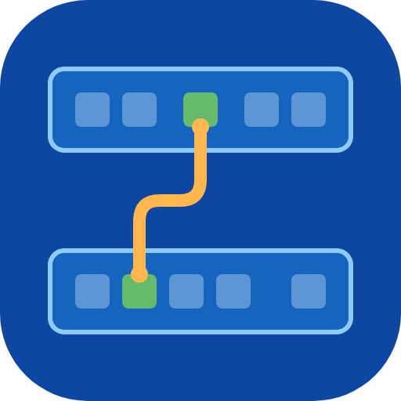
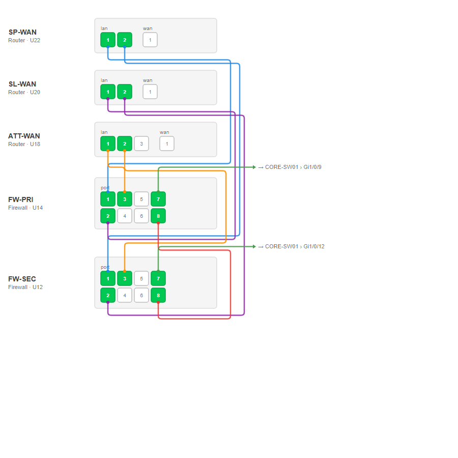
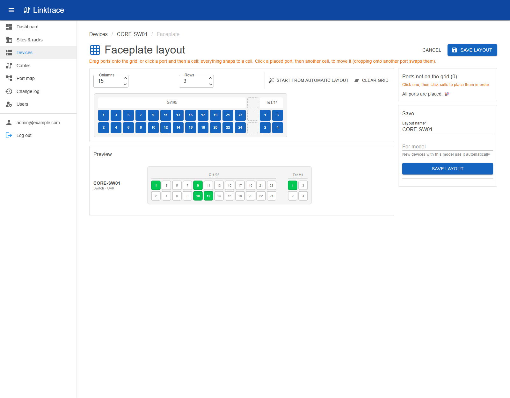

# Linktrace



Self-hosted cable tracing for network admins. Record your sites, racks, devices and every port-to-port cable, then
trace any port end to end, through patch panels and wall jacks, and see whole racks as a port map with every cable drawn.

Blazor Server (.NET 10) + MudBlazor + SQLite. Multi-user, runs as a single container.



## Features

- **Sites → rooms → racks → devices → ports.** Generate ports in bulk (48× `Gi1/0/x`, 24-port patch panels with front and rear pairs, wall jacks), or duplicate a device to make several copies with numbered names.
- **Cables** join two ports, with label, type, color, length and notes. A port holds one cable, and edits by two people at once can't overwrite each other.
- **Trace** any port end to end. Patch panel and wall jack front ↔ rear pass-throughs are followed automatically.
- **Faceplates** draw each device's ports the way the hardware looks: automatically, or laid out by hand on a snap-to-grid editor and shared by every device of the same model.
- **Port maps** stack devices (or a whole rack) top to bottom, side by side in a grid if you like, and route every cable between them, plus labelled stubs for cables that leave the map. Save and reopen maps, and **export them to PDF** for printing (Letter, Tabloid, A4, A3).
- **Racks:** put existing devices in a rack by dragging them onto a slot or picking a position; devices can be several U tall.
- **Connector types** beyond network ports: USB-C/A, power outlets (NEMA 5-15, C13, C19), power inlets (C14, C20) and DC, drawn as their shapes on faceplates.
- **Bulk port edits:** tick ports and change their side, connector or description together.
- **Device templates:** save a device (ports, pairs, faceplate layout) as a template, start new devices from it, and share templates as files with other Linktrace installs.
- **Export / import** everything as one JSON file, to back up or move to another instance.
- **Roles:** the first account is Admin; new accounts are read-only Viewers until promoted to Editor. Every change is in the change log.
- Light, dark or match-system theme, saved per user.



## Installing on a server (Beta and Production)

Images are published to `ghcr.io/007darkmatter5/linktrace` for `linux/amd64` and `linux/arm64`:

| Tag | Built from |
| --- | --- |
| `production`, `latest`, `<version>` | `main` |
| `beta`, `<version>-beta` | `beta` |

The container listens on port 8080 and keeps everything in two folders:

- `/data`: the SQLite database (`linktrace.db`)
- `/keys`: the keys that sign login cookies. Keep them with the data, or everyone is signed out after an update.

```bash
docker run -d --name linktrace -p 5010:8080 \
  -v /srv/linktrace/data:/data -v /srv/linktrace/keys:/keys \
  ghcr.io/007darkmatter5/linktrace:production
```

Open `http://<server>:5010` and register: the first account becomes the admin.

| Environment variable | Default | Purpose |
| --- | --- | --- |
| `PUID` / `PGID` | `1654` | User and group Linktrace runs as; it owns `/data` and `/keys`. Unraid uses 99/100. |
| `ASPNETCORE_FORWARDEDHEADERS_ENABLED` | `false` | Set to `true` behind a reverse proxy that handles HTTPS. The proxy must allow WebSockets (Blazor Server needs them). |

### Unraid

**Production from Community Apps:** in the **Apps** tab, search for **Linktrace** and click **Install**. The defaults work as they are: port 5010, data in `/mnt/user/appdata/linktrace/data`, keys in `/mnt/user/appdata/linktrace/keys`, running as `nobody:users` (99/100). Open the WebUI and register the first account (it becomes the admin). When a new production release is out, the Docker tab shows **update ready**. The template lives in [007darkmatter5/unraid-templates](https://github.com/007darkmatter5/unraid-templates/blob/main/templates/linktrace.xml).

**Beta:** use [`deploy/unraid/docker-compose.yml`](deploy/unraid/docker-compose.yml) with the **Docker Compose Manager** plugin:

1. **Docker** tab → **Compose** → **Add New Stack**, name it `linktrace-beta`.
2. On the stack's gear icon, **Edit Stack → Compose File**, paste the file and save.
3. **Compose Up**, then open `http://<unraid-ip>:5011`.

The beta stack uses its own port (5011) and appdata folder (`linktrace-beta`), so it can run alongside production. **Update Stack** pulls the newest beta. Database changes run automatically on start; back up appdata first (e.g. with the Appdata Backup plugin, or **Export / import** in the app).

### Release workflow

1. Push to the `beta` branch. GitHub Actions runs the tests, smoke-tests the container, publishes the Beta image and creates a pre-release (e.g. `v1.0.12-beta`).
2. Update Beta on the server and try it out.
3. Merge `beta` into `main` and push. That publishes the Production image and a release.

Version numbers are `<major.minor from the VERSION file>.<build number>`.

## Running from source

Requires the .NET 10 SDK.

```powershell
dotnet run --project src/Linktrace
```

The database is created and migrated on startup (`src/Linktrace/Data/linktrace.db`). Add `-- --seed-demo` to load a small sample network into an empty database. Run the tests with `dotnet test`.

## Moving to another server

**Export / import** in the menu downloads all network data (sites, rooms, racks, devices, ports, cables, faceplate
layouts, saved port maps) as one JSON file, also available at `GET /api/export`. Admins can import it into another
instance, either added to existing data (clashing names get "(imported)" appended) or replacing everything. The file is
checked and previewed first, and the import runs in a single transaction. User accounts and the change log are not
included. To move a whole install including accounts, copy the `data` and `keys` folders instead.

## How it's built

- **Model:** Site → Room → Rack → Device → Port. A **Cable** joins exactly two ports. A port can **pass through** to a paired port on the same device (patch panel front ↔ rear); tracing alternates cable → pass-through → cable until the path ends.
- Every record has a version stamp: if two people edit the same thing, the second save is rejected instead of silently overwriting.
- `src/Linktrace/Data`: entities, DbContext, migrations
- `src/Linktrace/Services`: business rules (validation, permissions, audit, tracing, faceplate layout, port map routing, export/import)
- `src/Linktrace/Components`: pages, dialogs, shared UI
- `tests/Linktrace.Tests`: service tests against in-memory SQLite

Add a migration with `dotnet ef migrations add <Name> --project src/Linktrace -o Data/Migrations`.

## License

[MIT](LICENSE)
